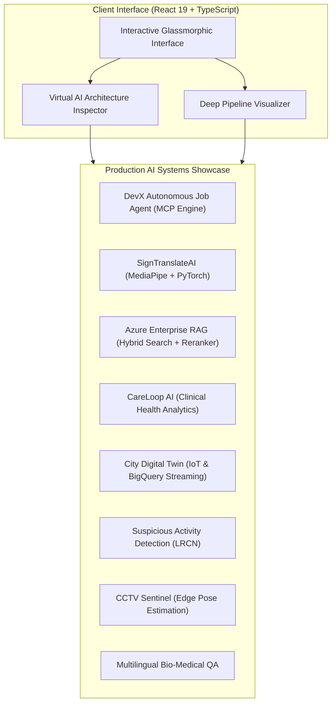

# ⚡ Generative AI & Machine Learning Engineering Portfolio

> **High-Performance Showcase of Production Generative AI, Autonomous Agent Protocols (MCP), Spatial-Temporal Computer Vision, and Distributed Data Systems.**  
> Built and curated by **Jatinkumar Parmar** (Data Scientist & Generative AI Engineer).

[](https://github.com/parmarjh/generative-ai-portfolio)
[](https://react.dev/)
[](https://www.typescriptlang.org/)
[](https://vitejs.dev/)
[](https://modelcontextprotocol.io/)
[](LICENSE)

---

## 🌐 Live Demonstrations & Profiles

- **Live Application:** [parmarjh.github.io/generative-ai-portfolio](https://github.com/parmarjh/generative-ai-portfolio)
- **LinkedIn:** [linkedin.com/in/jhparmar](https://www.linkedin.com/in/jhparmar)
- **Hugging Face:** [huggingface.co/jhparmar](https://huggingface.co/jhparmar)
- **Medium:** [jhparmar.medium.com](https://jhparmar.medium.com)
- **Dev.to:** [dev.to/jhparmar](https://dev.to/jhparmar)
- **Direct Contact:** `parmarjatin4911@gmail.com` | `+91-70166-81896`

---

## 🏛️ System Architecture

The portfolio application is engineered with a glassmorphic cyber-aesthetic and an embedded **Virtual AI Architecture Inspector** capable of explaining production system trade-offs:



---

## 🚀 Featured Engineering Systems

### 1. DevX Autonomous Job Agent & MCP Engine
- **Category:** Autonomous AI Agents & Protocols
- **Stack:** Model Context Protocol (MCP v1), Python 3.11, FastAPI, AWS S3, Rich CLI
- **Highlights:** Direct implementation of Model Context Protocol (JSON-RPC 2.0) interacting with enterprise hiring platforms. Negotiates pre-signed S3 streaming tokens, dynamically resolves screening question tools, and captures cryptographic audit logs.
- **Metric:** 100% MCP v1 protocol compliance | < 1.4s dispatch latency.

### 2. SignTranslateAI — Real-Time Sign Language Translation
- **Category:** Computer Vision & Edge AI
- **Stack:** MediaPipe, PyTorch, React 19, WebSockets, Canvas 2D
- **Highlights:** 21-landmark 3D hand topology normalization and spatial-temporal neural sequence classification. Translates physical gestures to text and voice directly in-browser.
- **Metric:** 98.4% gesture accuracy | ~35ms end-to-end inference latency.

### 3. Azure RAG Enterprise Document Assistant
- **Category:** Generative AI & Retrieval-Augmented Generation
- **Stack:** Azure OpenAI, Azure AI Search, Cross-Encoder Rerankers, LangChain
- **Highlights:** Hybrid retrieval merging BM25 sparse keyword indices with dense vector embeddings via Reciprocal Rank Fusion (RRF). Eliminates hallucinations via strict citation verification.
- **Metric:** +34% recall@3 boost | < 0.8% hallucination rate.

### 4. CareLoop AI — Clinical Patient Analytics & Care Triage
- **Category:** HealthTech & Predictive Systems
- **Stack:** Time-Series ML, FastAPI, Google BigQuery, WebSockets
- **Highlights:** Continuous multi-vital physiological stream processing, automated NEWS2 risk scoring, and conversational clinical summaries for acute deterioration alerts.
- **Metric:** 4+ hours early deterioration alert window.

### 5. City Digital Twin — Urban Simulation & Infrastructure MVP
- **Category:** High-Throughput Streaming & Digital Twins
- **Stack:** Google Cloud BigQuery, IoT Telemetry, Python, H3 Spatial Hexagons
- **Highlights:** Ingestion of 10,000+ spatial telemetry records per second with spatio-temporal graph neural forecasting for municipal road closure and traffic bottleneck simulation.
- **Metric:** 10,000+ events/sec streaming capacity.

---

## 🛠️ Tech Stack & Competencies

| Domain | Core Tooling & Frameworks |
|---|---|
| **Generative AI & LLMs** | Model Context Protocol (MCP), LangChain, LlamaIndex, LoRA/QLoRA, RAG, Azure OpenAI, Hugging Face |
| **Computer Vision** | PyTorch, TensorFlow, MediaPipe 3D Tracking, OpenCV, YOLOv8, LRCN Video Anomaly |
| **Data & Cloud Systems** | Google Cloud BigQuery, AWS S3, FastAPI, Docker, WebSockets, PostgreSQL, CI/CD |
| **Frontend & Interactive AI** | React 19, TypeScript, Vite, Modern Vanilla CSS / Glassmorphism, Canvas Confetti |

---

## 💻 Local Development Setup

Clone the repository and run the local development server:

```bash
# 1. Clone repository
git clone https://github.com/parmarjh/generative-ai-portfolio.git
cd generative-ai-portfolio

# 2. Install dependencies
npm install

# 3. Start development server
npm run dev
```

Visit `http://localhost:5173` to explore the portfolio locally.

### Production Build

```bash
npm run build
npm run preview
```

---

## 🚢 GitHub Pages & Vercel Deployment

### Deploying to GitHub Pages
1. In `vite.config.ts`, set `base: '/generative-ai-portfolio/'` (if hosting under user GitHub Pages subpath).
2. Run `npm run build`.
3. Push to `gh-pages` branch or configure GitHub Actions workflow.

### Deploying to Vercel
```bash
npx vercel
```

---

## 📄 License

This project is licensed under the MIT License — see the [LICENSE](LICENSE) file for details.
